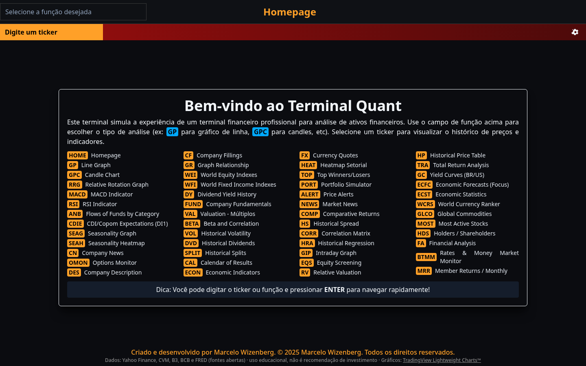

# Quant Terminal

Terminal financeiro **estático** (sem servidor) para análise de ativos brasileiros e globais, com visual âmbar/preto de terminal profissional. Cada tela é uma "função" acessada por código (ex.: `GPC PETR4`, `FA VALE3`, `CDIE`), como num terminal de mercado.

Publicado no GitHub Pages: https://celowiz.github.io/quant-terminal/

> Projeto educacional, não é recomendação de investimento. Dados de fontes abertas (Yahoo Finance, CVM, B3, BCB e FRED). Gráficos: TradingView Lightweight Charts™.



## Como funciona

- **Frontend:** Next.js 14 (App Router) com `output: 'export'` → HTML/JS estático em `out/`. Tailwind v4, gráficos com `lightweight-charts` v5.
- **Dados:** JSON em `public/data/`, gerados pelo pipeline Python (`pipeline/`). O site lê esses arquivos no navegador; não há API nem banco de dados.
- **Atualização:** o workflow `.github/workflows/pages.yml` roda o pipeline, faz o build e publica no Pages. Roda em push na `main`, manualmente (`workflow_dispatch`) e de terça a sábado às 07:47 BRT (dados do pregão anterior consolidados). Em pull requests ele só valida o typecheck e o build, sem deploy.
- **Desktop:** cada tela ocupa exatamente a janela (sem rolagem da página) e o rodapé fica sempre visível; tabelas longas rolam dentro do próprio painel. Testado em 1920×1080, 1536×864, 1440×900, 1366×768 e 1280×800.
- **Celular:** hoje a página rola normalmente; a proposta de layout mobile está em [docs/MOBILE.md](docs/MOBILE.md).

## Funções (61)

| Código | Função |
|---|---|
| `GP` | Line Graph |
| `GPC` | Candle Chart |
| `RRG` | Relative Rotation Graph |
| `MACD` | MACD Indicator |
| `RSI` | RSI Indicator |
| `ANB` | Flows of Funds by Category |
| `CDIE` | CDI/Copom Expectations (DI1) |
| `SEAG` | Seasonality Graph |
| `SEAH` | Seasonality Heatmap |
| `CN` | Company News |
| `OMON` | Options Monitor |
| `DES` | Company Description |
| `CF` | Company Fillings |
| `GR` | Graph Relationship |
| `WEI` | World Equity Indexes |
| `WFI` | World Fixed Income Indexes |
| `DY` | Dividend Yield History |
| `FUND` | Company Fundamentals |
| `VAL` | Valuation - Múltiplos |
| `BETA` | Beta and Correlation |
| `VOL` | Historical Volatility |
| `DVD` | Historical Dividends |
| `SPLIT` | Historical Splits |
| `CAL` | Calendar of Results |
| `ECON` | Economic Indicators |
| `FX` | Currency Quotes |
| `HEAT` | Heatmap Setorial |
| `TOP` | Top Winners/Losers |
| `PORT` | Portfolio Simulator |
| `ALERT` | Price Alerts |
| `NEWS` | Market News |
| `COMP` | Comparative Returns |
| `HS` | Historical Spread |
| `CORR` | Correlation Matrix |
| `HRA` | Historical Regression |
| `GIP` | Intraday Graph |
| `EQS` | Equity Screening |
| `RV` | Relative Valuation |
| `HP` | Historical Price Table |
| `TRA` | Total Return Analysis |
| `GC` | Yield Curves (BR/US) |
| `ECFC` | Economic Forecasts (Focus) |
| `ECST` | Economic Statistics |
| `WCRS` | World Currency Ranker |
| `GLCO` | Global Commodities |
| `MOST` | Most Active Stocks |
| `HDS` | Holders / Shareholders |
| `FA` | Financial Analysis |
| `BTMM` | Rates & Money Market Monitor |
| `MRR` | Member Returns / Monthly |
| `WIRP` | Rate Probabilities |
| `FOMC` | Fed & Copom Meetings |
| `WB` | World Bonds |
| `YAS` | Bond Yield & Spread Calculator |
| `ECO` | Economic Calendar (BR/US) |
| `TAYL` | Taylor Rule (BR/US) |
| `ECTR` | Trade Flows (Comex Stat) |
| `GMM` | Global Macro Movers |
| `FXC` | Currency Cross Rates |
| `FXFC` | FX Forecasts (Focus) |
| `DRSK` | Default Risk (Merton DD) |

Funções com ticker aceitam a URL `/<função>/<TICKER>/` (ex.: `/gpc/PETR4.SA/`).

## Fontes de dados (todas abertas e gratuitas)

| Fonte | Uso |
|---|---|
| Yahoo Finance (`yfinance`) | Preços OHLCV, índices mundiais, moedas, futuros, proventos, splits, perfil |
| CVM — dados abertos | DFP/ITR (demonstrações), FCA, IPE (fatos relevantes, calendário), FRE (acionistas), Informe Diário de Fundos (captação por classe) |
| B3 | Carteira teórica do Ibovespa, setores, DI1 (BDI), COTAHIST (opções) |
| BCB | SGS (Selic, CDI, IPCA…), Focus, Copom |
| FRED | Juros e indicadores dos EUA |
| IBGE SIDRA, Tesouro Transparente | Estatísticas econômicas, curva de títulos públicos, preços e taxas do Tesouro Direto (YAS, WB Brasil) |
| Fed (calendário do FOMC), BLS/BEA/Census | Reuniões do FOMC, calendário de indicadores dos EUA |
| Bank of Canada, Bundesbank, Bank of England, MoF Japão, RBA, OCDE (via FRED) | Juros de títulos soberanos (WB) |
| Comex Stat (MDIC/SECEX) | Exportações e importações por país (ECTR) |
| RSS de licença aberta | Agência Brasil, BCB, CVM, SEC, Fed, Receita Federal |

ANBIMA não é usada (os termos de uso proíbem automação); a função `ANB` usa as categorias da CVM.

## Pipeline

`pipeline/run_all.sh` roda cada etapa de forma independente (uma fonte fora do ar não derruba as outras; o job só falha se os preços não atualizarem):

`prices` → `markets` → `rates` → `corp` → `extra` → `macro` → `credit` → `options` → `news` → `anb` → `alerts`

Variáveis: `QT_DATA_OUT` (saída, padrão `public/data`), `QT_CACHE` (cache de downloads grandes), `QT_ALERTS` (regras em `alerts.yaml`). Nenhuma chave de API é necessária.

A função `ALERT` avalia `alerts.yaml`; se alguma regra disparar, o workflow abre uma issue.

## Rodar localmente

```bash
# 1) dados (Python 3.12)
pip install pandas yfinance requests pyyaml
QT_DATA_OUT=public/data bash pipeline/run_all.sh

# 2) site (Node 20)
npm ci
npm run dev            # http://localhost:3000/quant-terminal
# ou build estático:
NEXT_PUBLIC_BASE_PATH=/quant-terminal npx next build   # gera out/
```

Só `public/data/tickers.json` fica versionado (o build precisa dele para pré-gerar as páginas por ticker); o resto de `public/data/` é gerado pelo pipeline e fica fora do git.

## Manutenção

- **Keepalive mensal:** o GitHub desativa workflows agendados após 60 dias sem atividade no repositório. O workflow `.github/workflows/keepalive.yml` roda todo dia 1 às 09:53 BRT (`53 12 1 * *` UTC) e também pode ser disparado à mão (`workflow_dispatch`). Ele grava o horário UTC atual em `.github/keepalive` e faz o commit `chore: keepalive mensal` na `main` como `github-actions[bot]`, só se o arquivo mudou.
- Ele fica num workflow separado, o único com `contents: write`. O `pages.yml` (pipeline + deploy) continua só com leitura do conteúdo.
- Commits feitos com o `GITHUB_TOKEN` não disparam outros workflows, então o keepalive não gera deploy extra. O deploy diário segue no cron do `pages.yml`.

## Estrutura

```
src/              app Next.js (rotas em src/app, telas em src/views, componentes em src/components)
public/data/      JSON gerados pelo pipeline (só tickers.json versionado)
pipeline/         scripts Python de coleta/transformação
alerts.yaml       regras da função ALERT
.github/workflows/pages.yml   pipeline + build + deploy no Pages
docs/             PLANO.md, REFERENCIAS.md, MOBILE.md, screens/, favicon/ (fonte SVG do favicon: tecla âmbar "QT")
legacy/           código original (backend FastAPI/Prefect + frontend React), mantido como referência; não é usado no build
```

## Legado

`legacy/` guarda o projeto original do primeiro commit (API FastAPI, pipeline Prefect com SQLite, frontend React). Não roda no Pages. Os extratores ANBIMA que estão lá não são usados.

---

Criado e desenvolvido por Marcelo Wizenberg. © 2025 Marcelo Wizenberg. Todos os direitos reservados.
